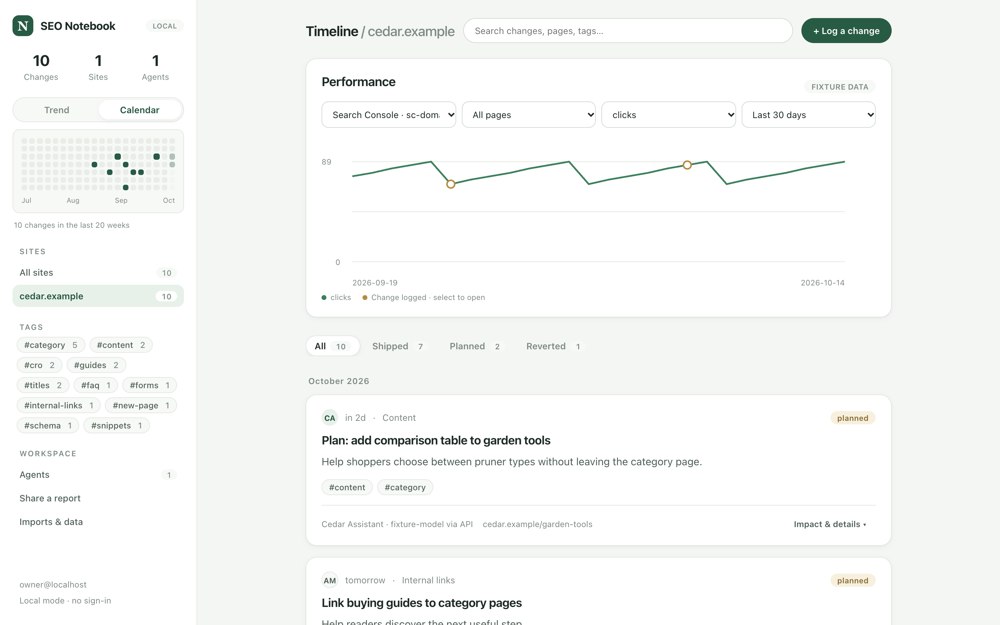
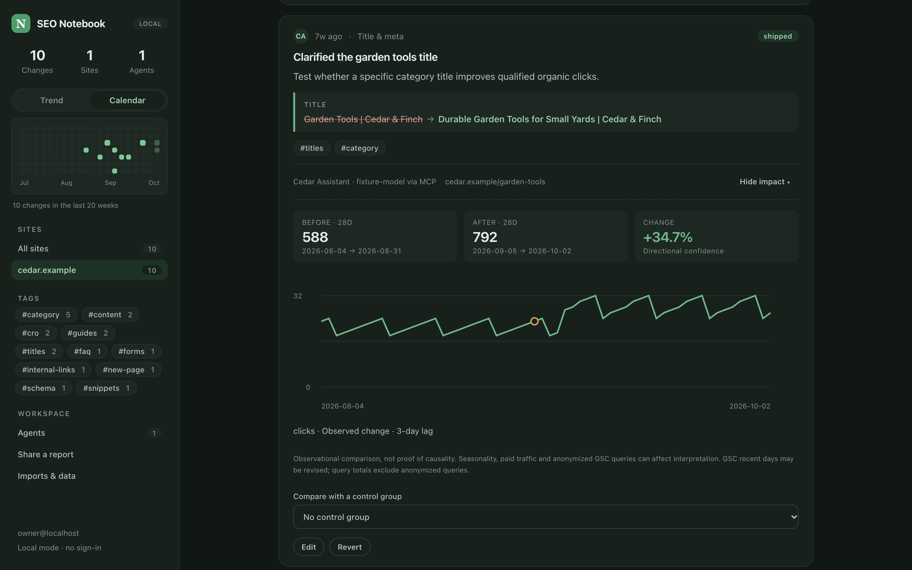

# SEO Notebook

[](https://deploy.workers.cloudflare.com/?url=https://github.com/evankrob/seo-notebook) · [seonotebook.dev](https://seonotebook.dev)

A self-hosted change log that your AI agents write to. When an agent edits a page (a title, a meta description, an H1, a block of content), it records what changed, the old and new values, and why. The notebook then lines those changes up against Google Search Console and Google Analytics so you can see the before and after.

- **Agent-first.** Agents connect over MCP and log changes by URL. Sites and pages are created automatically from the domain; nobody sets anything up by hand. Manual logging in the UI is still there.
- **Yours.** Deploy it to your own Cloudflare account, or run it locally. There is no hosted service and no separate sign-in: on Cloudflare, [Cloudflare Access](https://developers.cloudflare.com/cloudflare-one/policies/access/) decides who can open the notebook.
- **Honest impact.** Before/after windows, overlap detection, optional control groups and a confidence label that stays "Inconclusive" until the data supports more.





<sub>Screenshots use the fictional demo data from `npm run setup`.</sub>

> **Status:** Search Console and GA4 data come from your Google service account; see [Connect Google data](#connect-google-data). Local development and tests use fixture data.

## Run locally

Requires **Node 22.14+**. Everything runs inside Wrangler with local D1, R2 and Queues.

```sh
npm ci
npm run setup      # local migrations + fictional demo data
npm run dev        # http://localhost:8787
```

Optional local settings (your own `LOCAL_USER_EMAIL`, a Google key) go in `.dev.vars`; start from `cp .dev.vars.example .dev.vars`.

Locally there is no login: requests to `localhost` act as `LOCAL_USER_EMAIL` (default `owner@localhost`). This only applies when Cloudflare Access is not configured and the request host is a loopback address. The demo data belongs to a fictional store, **Cedar & Finch Supply** at `cedar.example`, and includes a demo agent token, `demo-agent-token-not-a-secret`. Never load the demo data into a deployed notebook.

```sh
npm run check             # TypeScript + lint + tests (what CI runs)
node scripts/stress.mjs   # load/robustness run against npm run dev
```

## Deploy to your Cloudflare

**One click:** the **Deploy to Cloudflare** button above copies this repository into your GitHub account, creates the D1 database, R2 bucket and Queue, applies the migrations and deploys the Worker. Leave `ACCESS_TEAM_DOMAIN` and `ACCESS_AUD` empty when it asks; you fill them in after the first deploy.

**From a clone:** `npx wrangler login`, then:

```sh
npx wrangler deploy   # first time: creates the D1 database, R2 bucket and Queue
npm run deploy        # applies migrations, then deploys; use this from now on
```

`wrangler.toml` holds working defaults (Worker `seo-notebook`, D1 `seo-notebook`, R2 `seo-notebook-uploads`, Queue `seo-notebook-jobs`) with no resource IDs; Wrangler finds or creates the resources by name.

### After you deploy

Until Cloudflare Access is configured, the notebook shows a setup page and nothing else: no data and no API access.

1. **Protect the UI with Cloudflare Access.** In Zero Trust → Access → Applications, add a self-hosted application for the Worker's hostname (e.g. `seo-notebook.<you>.workers.dev`) with an Allow policy listing the people who may use the notebook. Everyone it lets in is a notebook admin.
2. **Let agents through to `/mcp`.** Add a second Access application for the same hostname with path `mcp` and a **Bypass** policy. Agent bearer tokens protect that path.
3. **Tell the Worker about Access.** Set `ACCESS_TEAM_DOMAIN` (e.g. `yourteam.cloudflareaccess.com`) and `ACCESS_AUD` (the first application's *Application Audience (AUD) Tag*) under `[vars]` in your repository's `wrangler.toml`, then deploy again (a push redeploys a button deploy). Set them in the file rather than the dashboard: each deploy replaces dashboard variables with the file's. The Worker verifies the Access JWT on every request.
4. **Optional: Google data.** Add the `GOOGLE_SERVICE_ACCOUNT` secret; see [Connect Google data](#connect-google-data).

`preview_urls = false` is set because preview URLs are not covered by Access.

### Keeping your production settings out of git

If you deploy from a clone of this public repository rather than your own copy, keep your account's values in a gitignored file instead of editing `wrangler.toml`:

```sh
cp wrangler.production.toml.example wrangler.production.toml   # fill in Access values and the D1 database ID
npx wrangler d1 migrations apply DB -c wrangler.production.toml --remote
npx wrangler deploy -c wrangler.production.toml
```

Pass `-c wrangler.production.toml` to `wrangler secret put` and `wrangler tail` too.

## Connect Google data

The notebook reads Search Console and GA4 with a Google **service account**. Its JSON key is a Worker secret and is never stored in the database.

1. In the service account's Google Cloud project, enable the **Google Search Console API**, the **Google Analytics Data API** and, for the property pick list, the **Google Analytics Admin API**.
2. Store the key:
   ```sh
   npx wrangler secret put GOOGLE_SERVICE_ACCOUNT < service-account.json
   ```
   Locally, put it in `.dev.vars` on one line: `GOOGLE_SERVICE_ACCOUNT='<output of jq -c . service-account.json>'`.
3. Give the service account's email read access: in Search Console, *Settings → Users and permissions* (Restricted is enough); in GA4, *Admin → Property access management* (Viewer).
4. In the notebook, choose **Imports & data → Connect Google data**, pick the site's Search Console and GA4 properties, and connect.

Connecting pulls 16 months of history for the site's pages. After that a daily cron re-pulls the last 7 days (Google revises recent data), and any page an agent logs for the first time gets its history pulled automatically. Only pages in the notebook are synced: Search Console is queried per page; GA4 reports **Organic Search** sessions and key events by landing page. The last three days are marked `fresh` and do not count towards scored impact windows. When a page is first logged, the notebook stores the URL Search Console reports for it (e.g. `https://www.example.com/` for `http://example.com/`). It picks the http/https and www variant with the most impressions in the last 90 days. If Search Console has none, it follows the URL's redirects. If both fail, it keeps the URL as sent.

## Connect an agent

Open the notebook, choose **Agents → Connect an agent**, and name it (e.g. "Claude Code · brightwax-site repo"). You get a one-time token and ready-made config:

```sh
claude mcp add --transport http seo-notebook https://<your-notebook>/mcp \
  --header "Authorization: Bearer <token>"
```

```json
{ "mcpServers": { "seo-notebook": { "url": "https://<your-notebook>/mcp", "headers": { "Authorization": "Bearer <token>" } } } }
```

Then add one line to the agent's project rules (`CLAUDE.md`, `AGENTS.md`, `.cursorrules`) so it logs every edit. The setup screen gives you the exact text; [docs/agent-guide.md](docs/agent-guide.md) has the full workflow. Each agent gets its own token, so its changes are attributed to it and it can be revoked on its own.

## What an agent sends

```json
{
  "url": "https://www.brightwax.example/brow-wax/",
  "summary": "Rewrote the title and meta description",
  "rationale": "Match the dominant query wording from Search Console",
  "diff": [
    { "field": "title", "before": "Brow Wax", "after": "Brow Wax in Springfield | Bright Wax" },
    { "field": "meta_description", "before": null, "after": "Book a brow wax in Springfield." }
  ],
  "evidence": ["https://github.com/acme/brightwax-site/pull/42"],
  "idempotency_key": "brightwax-brow-wax-title-2026-10-19"
}
```

- **Target:** `url` or `urls` (one site per change; `www.` and the bare domain are the same site), or `site` plus `sitewide: true`. Query strings and fragments are dropped from page URLs.
- **`diff` fields:** `title`, `meta_description`, `h1`, `headings`, `content`, `canonical`, `robots`, `schema`, `redirect`, `internal_links`, `images`, `url`, `other`. Up to 20 entries, 5,000 characters per value; agents should excerpt long content.
- **Defaults:** `occurred_at` is today in `timezone` (default UTC), `status` is `shipped`, `type` is inferred from the diff (title/meta → `title_meta`), and `expected_metric` is `clicks`.
- The author is always the authenticated agent; author fields cannot be sent.

## MCP tools

Served at **`/mcp`** (Streamable HTTP, stateless, JSON responses), bearer token required.

| Tool | Purpose |
|---|---|
| `log_change` | Record a change by URL with old → new values. Retry with the same `idempotency_key`. |
| `update_change` | Mark a planned change `shipped`, mark one `reverted`, or correct details. |
| `list_sites` | Sites with page and change counts and the latest change date. |
| `list_changes` | Changes, newest first; filter by `site`, `url`, `since`, `until`. |
| `get_impact` | Before/after readout with confidence, overlaps and caveats. |

## REST API

The browser UI uses these with the Access session. Agent bearer tokens also work, but in production only `/mcp` bypasses Access, so agents should use MCP. Errors are `{ "error": "..." }`. Cookie-authenticated writes must come from the notebook's own origin.

| Method | Path | Purpose |
|---|---|---|
| GET | `/v1/me` | Current identity and auth mode (`access`, `local` or `token`) |
| GET | `/v1/sites` | Sites with counts |
| GET / POST | `/v1/clients` | List sites / create one from `{domain,name?,timezone?}` |
| GET | `/v1/clients/:id/context` | A site's properties, pages and groups |
| POST | `/v1/pages`, `/v1/groups`, `/v1/properties` | Create site entities |
| POST | `/v1/properties/:id/sync?backfill=true` | Queue fixture backfill; omit the flag for a seven-day refresh |
| GET / POST | `/v1/changes` | List (`?site=&client=&url=&since=&until=`) / create (same body as `log_change`; `Idempotency-Key` header) |
| PATCH | `/v1/changes/:id` | Edit, ship or revert |
| GET | `/v1/impact/:id?control=&property=&metric=&days=28&lag=3` | Before/after readout |
| GET | `/v1/timeline?client=&property=&page=&metric=&since=` | Daily series and change markers |
| POST | `/v1/metrics/import?client=`, `/v1/changes/import?client=` | Raw CSV (or JSON for metrics) → R2 + Queue |
| GET | `/v1/imports/:id` | Import status |
| GET / POST / DELETE | `/v1/agents`, `/v1/agents/:id` | List, create (one-time token) and revoke agents |
| POST / DELETE | `/v1/reports`, `/v1/reports/:id` | Create / revoke a read-only report link |

Public report endpoints are GET-only: `/reports/:token`, `/public/reports/:token`, `/public/reports/:token/export.csv`. Behind Access they are only reachable by people the Access policy allows, unless you add a Bypass for those paths too.

## CSV / JSON import

Send the raw CSV as `Content-Type: text/csv`, not multipart. The browser upload form does this for you. Maximum 1 MB and 5,000 rows; quoted commas, quotes, CRLF and multiline cells are supported. Parsing happens in the Queue consumer, after R2 storage. Failed jobs retain an error for inspection and Queue retries. Invalid metric files are fully validated before any rows are written; historical change imports are idempotent per row and may retain valid earlier rows if a later row fails client/scope checks. Reuploading creates a new import, while Queue retries reuse the original job.

[fixtures/metrics.csv](fixtures/metrics.csv): `property_id,page_id,date,metric,value,data_state`. `data_state` defaults to `final` when omitted; values must be finite and nonnegative. A JSON array of equivalent records is also accepted at the metrics endpoint. Supported metrics: `clicks,impressions,ctr,position,sessions,key_events,revenue,custom`.

[fixtures/changes.csv](fixtures/changes.csv): `occurred_at,timezone,status,type,page_id,summary,rationale`. Use optional `group_id` instead of `page_id`, or `sitewide=true`. Imported entries are attributed to the authenticated importer; historical authors cannot impersonate other agents. Existing records are updated only through PATCH. CSV exports escape formula-leading cells to prevent spreadsheet execution.

## Impact method

For change day **D**, defaults are **D−28 … D−1**, exclude **D and D+1 … D+3**, then **D+4 … D+31**. Override days (7–180) and lag (0–60) using REST/MCP. Any missing treatment page-day, fresh point, future end date, planned/reverted status, or new-page change prevents scoring. Missing dates are never filled with zero. New pages require a future predecessor/query-baseline feature; this MVP explicitly leaves them inconclusive.

Count metrics sum daily values. CTR and position use impression-weighted means; complete final impression coverage is required. Lower position values are better. Plain delta = after − before; percentage = (after / before − 1) × 100, null if baseline is zero. Optional control adjustment = treatment percentage growth − control percentage growth (percentage points); this is a descriptive normalized difference-in-differences, not a fitted causal model.

Confidence is a documented heuristic, **not a p-value**:

- **Inconclusive**: incomplete/ineligible windows; either period under 100 clicks/sessions/key events; other metrics without volume calibration; any overlapping change; or supplied controls with missing data, zero baseline or disagreeing direction.
- **Directional**: complete shipped treatment, both periods ≥100 on a calibrated volume metric, no overlaps, no control.
- **Strong**: the same conditions plus complete controls whose adjusted direction agrees with observed direction.

Overlaps include other shipped or reverted changes dated within either window or the lag interval whose resolved page scope intersects treatment pages, including groups and sitewide/external events. Planned entries are excluded. Controls should also be checked manually for changes; automatic clean-control selection is deferred. The UI warns about seasonality, paid traffic, GSC lag/revisions, query privacy filtering, low volume and lack of causal attribution. GA4 fixtures represent landing-page sessions and key events; real organic channel filtering remains a live-connector task.

## Architecture

- `apps/api`: TypeScript Hono Worker: Access/agent auth, REST, MCP, Cron and Queue handlers, D1 persistence.
- `apps/web`: dependency-free browser UI with SVG charts, served as Worker assets.
- `packages/impact`: pure, tested windowing and scoring. `packages/connectors`: fixture GSC/GA4 data, the live Google service-account client (`google.ts`) and the CSV parser.
- `migrations`, `fixtures`, `tests`: schema, fictional demo data, unit tests and Worker + real-SQLite integration tests.

One D1 database per notebook. A notebook holds many sites, and every query is scoped to the workspace of the authenticated person or agent.

## Roadmap

1. **Sign in with Google (OAuth)** as an alternative to the service account.
2. **Automatic page snapshots** when a change is logged (title, meta, headings, text hash), so there is a record even when an agent sends little.
3. **PR and commit links** as structured fields rather than plain evidence URLs.

## Contributing and security

See [CONTRIBUTING.md](CONTRIBUTING.md). Report vulnerabilities privately as described in [SECURITY.md](SECURITY.md). Released under the [MIT License](LICENSE).
